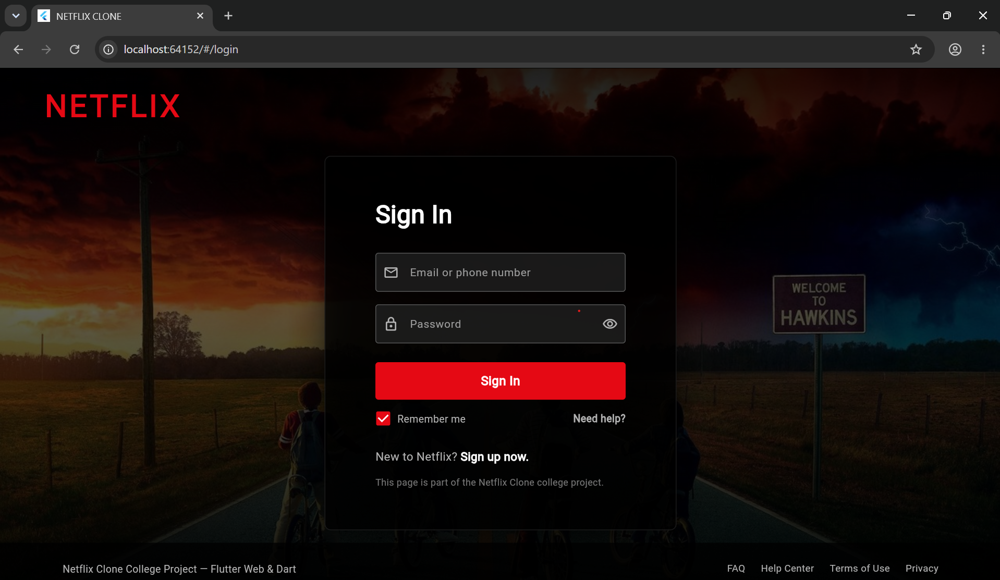
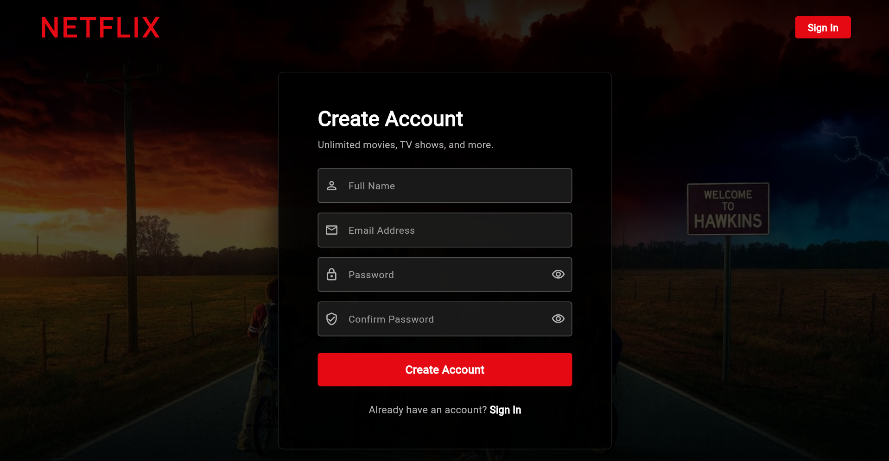
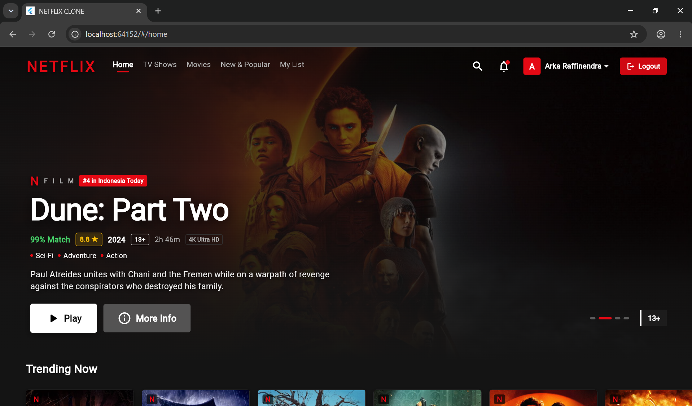

# Netflix Clone — Flutter Web

Website replika antarmuka Netflix yang dikembangkan menggunakan **Flutter dan Dart** sebagai project tugas kuliah.

Project ini mengadaptasi tampilan visual Netflix dengan tema Dark Mode, desain cinematic, dan navigasi sederhana. Website terdiri dari halaman Login, Register, dan Dashboard yang menampilkan berbagai kategori film.

Project ini dibuat untuk tujuan pembelajaran dan demonstrasi pengembangan antarmuka website menggunakan Flutter.

---

## Preview

| Login Page | Register Page |
|:---:|:---:|
|  |  |

| Dashboard |
|:---:|
|  |

---

## Features

Project ini memiliki beberapa fitur utama:

### 1. Login Page
- Tampilan login terinspirasi dari Netflix.
- Background cinematic.
- Input email dan password.
- Fitur Show/Hide Password.
- Tombol Sign In.
- Navigasi menuju halaman Register.

### 2. Register Page
- Form pendaftaran pengguna.
- Input nama lengkap, email, dan password.
- Fitur Show/Hide Password.
- Navigasi kembali ke Login Page.

### 3. Netflix Dashboard
- Navigation Bar dengan identitas Netflix.
- Hero Banner untuk film unggulan.
- Kategori Trending Now.
- Popular on Netflix.
- Top 10 Movies.
- Action Movies.
- Recommended for You.
- Continue Watching.
- Movie Posters dengan horizontal scrolling.
- Profil pengguna menggunakan nama **Arka Raffinendra**.

### 4. Additional Features
- Responsive layout.
- Dark Mode.
- Cinematic background.
- Movie poster dari internet.
- Hover effects dan animasi antarmuka.
- Navigasi antarhalaman.

---

## Technologies Used

| Technology | Description |
|---|---|
| Flutter | Framework pengembangan aplikasi |
| Dart | Bahasa pemrograman |
| Visual Studio Code | Code editor |
| Flutter Web | Target platform |
| Material Design | Komponen antarmuka |
| Internet Images | Poster dan backdrop film |

---

## Requirements

Sebelum menjalankan project, pastikan perangkat sudah memiliki:

- Flutter SDK.
- Dart SDK (termasuk dalam Flutter SDK).
- Visual Studio Code.
- Flutter Extension untuk VS Code.
- Google Chrome atau browser lainnya.
- Git (opsional, untuk mengelola repository).

Periksa instalasi Flutter menggunakan:

```bash
flutter doctor
```

---

## Installation & How to Run

Ikuti langkah berikut untuk menjalankan project di komputer lokal.

### 1. Clone Repository

Buka terminal dan jalankan:

```bash
git clone https://github.com/USERNAME/netflix-flutter-clone.git
```

Ganti `USERNAME` dengan username GitHub pemilik repository.

### 2. Masuk ke Folder Project

```bash
cd netflix-flutter-clone
```

### 3. Install Dependencies

Jalankan perintah:

```bash
flutter pub get
```

Perintah ini digunakan untuk mengunduh dan memasang dependency yang dibutuhkan project.

### 4. Jalankan Website

Pastikan Chrome sudah terpasang, kemudian jalankan:

```bash
flutter run -d chrome
```

Flutter akan menjalankan website melalui browser Google Chrome.

### 5. Build untuk Web (Optional)

Jika ingin membuat hasil build website, jalankan:

```bash
flutter build web
```

Hasil build akan tersedia di folder:

```text
build/web/
```

---

## Project Structure

Berikut gambaran struktur project:

```text
netflix-flutter-clone/
│
├── lib/
│   ├── main.dart
│   │
│   ├── pages/
│   │   ├── login_page.dart
│   │   ├── register_page.dart
│   │   └── home_page.dart
│   │
│   ├── widgets/
│   │   ├── netflix_logo.dart
│   │   ├── navbar.dart
│   │   ├── hero_banner.dart
│   │   └── movie_card.dart
│   │
│   └── data/
│       └── movie_data.dart
│
├── assets/
│   ├── images/
│   └── icons/
│
├── web/
├── test/
├── pubspec.yaml
├── pubspec.lock
└── README.md
```

*Catatan: Struktur di atas merupakan gambaran dokumentasi. Sesuaikan dengan file dan folder yang benar-benar tersedia di repository.*

---

## Authentication Information

Project ini menggunakan simulasi navigasi tanpa sistem autentikasi sungguhan.

- Tidak menggunakan backend.
- Tidak menggunakan database.
- Tidak memerlukan akun demo.
- Tombol Sign In langsung mengarahkan pengguna ke Dashboard.
- Halaman Register hanya digunakan sebagai simulasi tampilan pendaftaran.
- Nama profil dashboard ditampilkan sebagai Arka Raffinendra.

Project ini berfokus pada pengembangan UI/UX dan bukan sistem autentikasi untuk penggunaan produksi.

---

## Design Concept

Desain website mengadaptasi identitas visual Netflix dengan beberapa karakteristik:

- Dark Cinematic Theme.
- Dominasi warna hitam.
- Aksen merah khas Netflix.
- Movie Poster Layout.
- Large Hero Banner.
- Minimalist Navigation Bar.
- Responsive Interface.

Tujuannya adalah menghadirkan pengalaman visual yang menyerupai platform streaming film Netflix.

---

## Project Information

**Project Name:** Netflix Clone Website

**Framework:** Flutter

**Programming Language:** Dart

**Platform:** Web

**Project Type:** University Assignment

**Developer:** Arka Raffinendra

**Purpose:** Educational Project

---

## ⚠️ Disclaimer

Project ini dibuat hanya untuk tujuan edukasi dan pembelajaran.

Netflix merupakan merek dagang milik Netflix, Inc. Project ini bukan aplikasi resmi Netflix dan tidak memiliki afiliasi dengan Netflix, Inc.

Seluruh hak atas logo, poster film, gambar, dan materi terkait tetap menjadi milik pemegang hak masing-masing.

---

## 📌 License

Project ini dibuat untuk kebutuhan pembelajaran dan tugas akademik. Penggunaan kembali kode dan aset harus tetap memperhatikan lisensi serta hak cipta masing-masing pemilik.